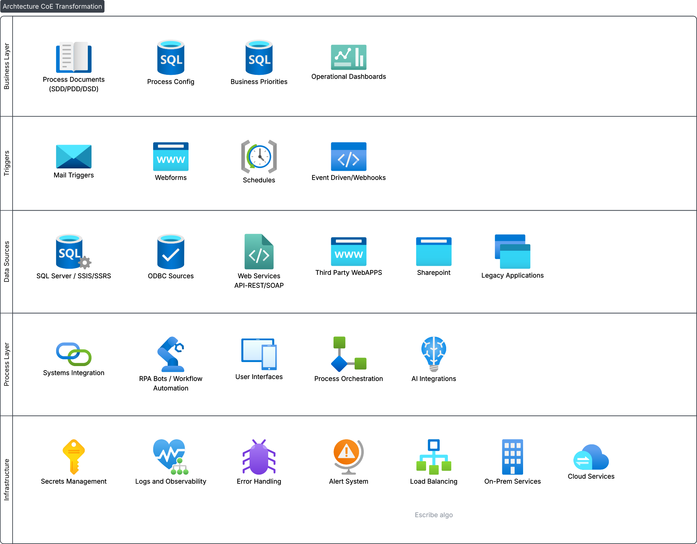

---
# Project settings - see projects/idp-platform/index.md for an explanation of each field.
# This project is a PLACEHOLDER - replace it with your own.
title: Workflow Orchestration Modernization
summary: Optimized legacy workflows, defined orchestration mechanism to enable multiple input channels and load balancing, organized and standardized development practices by leveraging DevOps principles.
tags: UiPath, SQL Server, Azure DevOps, UiPath Apps, Git
cover: architecture-diagram.svg
---

## Context

While working as a consultant in a staff augmentation model, I supported a client in Venture Capital that was struggling to manage a large workflow catalog. I was requested to help stabilize and scale and transform their automation program into a viable center of excellence.

- Production Errors
- Underutilized infrastructure
- Unclear governance
- Process SLAs not met

## What I did

**Mitigation Phase**
- Assessment
    - Identify critical workflows
    - Gather documentation
    - Drafted a workflow catalog
    - Determined workflow priorities
- Delivery
    - Applied urgent bugfixes and critical security patches to critical workflows

**Standardization and Optimization Phase**
- Assessment
    - Standardized log structure
    - Implemented observability mechanisms
    - Designed dashboards for health monitoring and productivity
    - Adopted ticketing system
    - Identified recurrent issues, technical debt and bottlenecks
    - Identified refactor candidates
- Standards
    - Defined development standards guideline
    - Adopted Git and CI/CD in Azure DevOps
    - Customized ReFramework to tailor business needs
    - Deprecated non-utilized workflows
    - Implemented alerting and ownership rules
- Optimization
    - Deprecated legacy undocumented macros, replaced them with automation rules
    - Replaced manual report extracts with API calls and SQL queries
    - Eliminated redundant workflows
    - Refactored where needed
    - Designed and developed centralized dispatching workflow to dynamically assign and prioritize workflows
    - Remapped server allocation rules to enable load balancing

## Results

- One place to monitor and audit every job
- Reduced production erros by 60%
- Increased workflows meeting SLA by 40%

## Architecture

