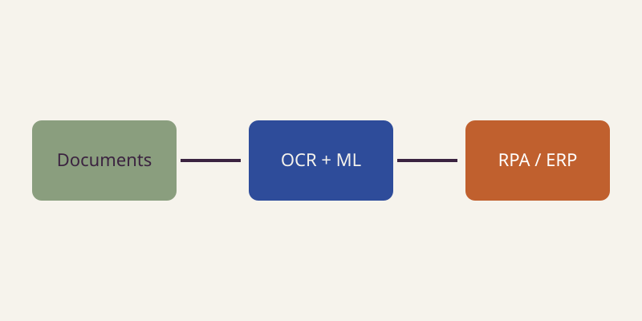

---
# ============================================================
#  PROJECT
#  title   -> shown on the card and the project page
#  summary -> short text shown on the card (1-2 sentences)
#  tags    -> comma-separated, shown as badges
#  cover   -> optional image file in THIS folder, shown on top
#             of the card and the project page
#  Everything below the second "---" is the full project page
#  (regular Markdown). Images in this folder are referenced by
#  file name only, e.g. 
#  This project is a PLACEHOLDER - replace it with your own.
# ============================================================
title: Intelligent Document Processing Workflow
summary: AI powered automated workflow for reading and extracting information from structured PDF documents
tags: n8n, Claude, REST API, JavaScript, Sharepoint
cover: diagram.svg
---

## Context

A medium size corporation required to analyze and extract key information from structured PDF documents, the information will be utilized for order processing as part of the Order to Cash process.
- **Information Source**: REST API Order management system
- **Document Storage**: Sharepoint
- **Document Variants**: 9
- **Target System**: CRM System 

## What I did

- Designed the end-to-end solution architecture as Solution Architect
- Created API integrations for input and target system
- Created Agent to extract relevant fields from the documents
- Defined context criteria to identify document variants
- Developed html view to integrate human-in-the-loop validations when required
- Set up monitoring and operational governance

## Architecture

## Results

- Significant reduction in manual processing time
- Consistent data quality with a human-in-the-loop for exceptions
